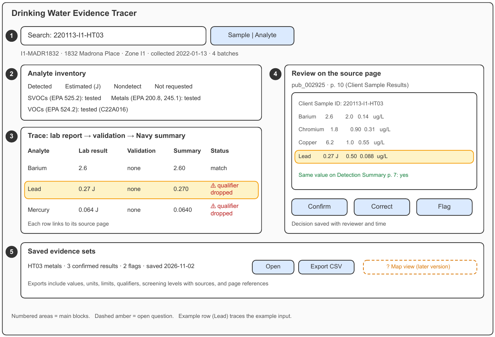
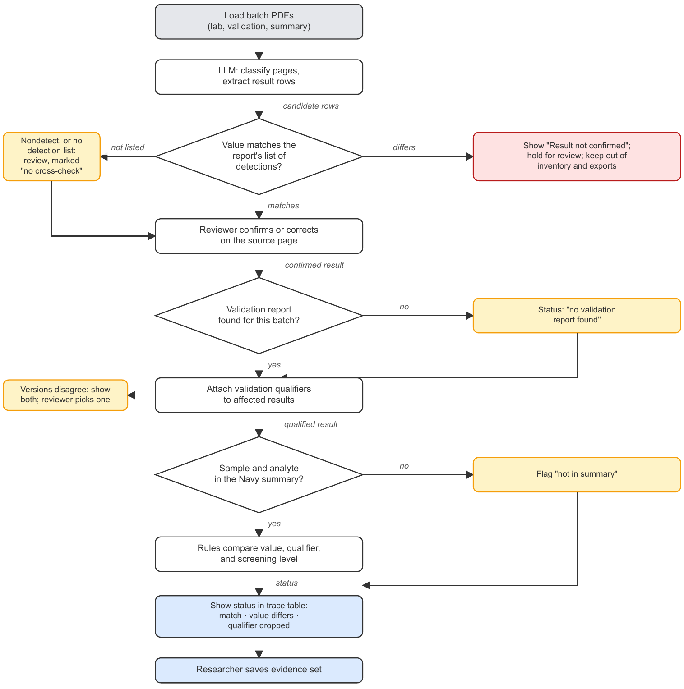
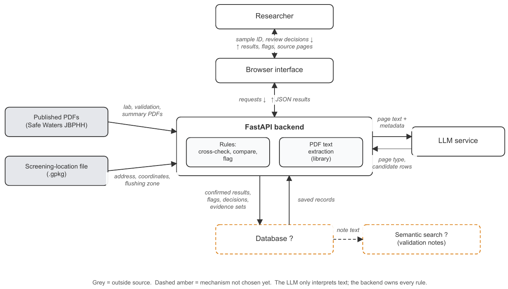

# ICS 603 Final Project Proposal

**Author:** Alemarie Ceria  
**Project title:** Drinking Water Evidence Tracer  
**Course:** ICS 603, Fall 2026

## 1. Project goal

A research evidence tool that helps environmental researchers trace Zone I1 (Red Hill Housing) drinking water results in the Navy's Stage 4 (post residential and non-residential flushing) laboratory reports, showing what was tested, what was detected, and the source page behind each result.

## 2. Intended user and problem

**Users:** environmental researchers (chemists, hydrologists, environmental engineers, and public health researchers) studying how the November 2021 jet fuel release affected the Joint Base Pearl Harbor-Hickam (JBPHH) drinking water system.

The Navy published Zone I1's Stage 4 evidence as [109 separate documents][stage-4-reports]. One sample's results are split across batches (220113-I1-HT03 was analyzed in four batches by four laboratories), and each batch can have a lab report, a validation report, a review report, and revisions. The Navy's summary table combines the results without showing their sources, so a researcher must connect the documents by hand to learn what was tested, which results are estimated or qualified, and whether the summary matches the lab reports. In a manual review of one batch, I found that the summary prints estimated values as plain numbers, and that the lab report's "No Detections" for six samples covered only semivolatile organics; their metals results are in a different laboratory's report.

## 3. Example input

A researcher selects sample 220113-I1-HT03 and asks to trace its results. The application uses the lab, validation, and review reports of the four batches that analyzed it (810-12264-1, C22A016, 580-109324-1, and 2A14029) and the Navy's summary table, all public PDFs from the Safe Waters JBPHH website.

## 4. Sample input set

Nine real inputs (none synthetic), drawn from 27 public PDFs in the repository's `data/reports/v1/`. Row 1 checks that the application does not flag everything.

| ID | Input | Expected result |
| --- | --- | --- |
| 1 | Barium, 220113-I1-HT02 | Lab 2.8 µg/L; summary 2.80: **match** |
| 2 | Lead, 220113-I1-HT03 | Lab 0.27 J µg/L (reporting limit 0.50); summary 0.270: **qualifier dropped** |
| 3 | Analyte inventory, 220113-I1-JT05 | Semivolatile organics from 810-12264-1 (all nondetect); metals and TOC from DA40915 (copper 4.0 µg/L; summary 4.00); VOCs from C22A016; petroleum hydrocarbons from 580-109324-1. Under 810-12264-1, metals read **not requested in this batch** |
| 4 | Mercury, 220113-I1-HT02 | Nondetect; its detection limit (0.056 µg/L) exceeds the 0.025 µg/L project screening level, and the summary uses 2 µg/L: **nondetect cannot show the screening level was met**, **screening levels conflict** |
| 5 | Sample 220113-I1-JT01 | Lab results (e.g., barium 2.7 µg/L) but no summary column: **not in summary** |
| 6 | VOCs, 220115-I1-GT01 (batch DA40928) | **recommended: UJ** (improper preservation), citing review report pub_003032 |
| 7 | Validation reports, batch 810-12460-1 | Both kept: **versions disagree** on whether a lab accuracy check was reviewed (pub_002988) or assumed within limits (pub_002989) |
| 8 | Sample 220118-I1-WT07 | Results in two batches: **no validation report found** |
| 9 | Sample 220115-I1-ET01 | pub_003000 lists VOCs, SVOCs, petroleum hydrocarbons, pesticides, and metals in batch DA40955, which has no lab report in the Stage 4 listing: **no lab report in the Stage 4 listing** |

## 5. Expected result and value

**User outcome:** the researcher sees every documented result for a sample or analyte, with its qualifiers, validation status, source-page link, and any difference from the Navy's summary. **Observable improvement:** I will trace one sample by hand, recording the time taken and the discrepancies found; the application should reproduce those discrepancies for the sample input set in a single lookup.

## 6. Big-picture sketch

Areas: (1) find a sample or analyte; the header shows location, address, zone, collection date, and number of batches; (2) analyte inventory (Feature 1); (3) trace (Feature 2), with the example Lead row highlighted; (4) review on the source page: confirm, correct, or flag; (5) saved evidence sets (Feature 3). Open question (?): whether a map view belongs in a later version.

## 7. Workflow and component sketches

Tracing HT03 through both diagrams: the LLM classifies pub_002925 p. 10 as client sample results and extracts "Lead, 0.27 J, RL 0.50," which matches the Detection Summary on p. 7; a reviewer confirms it. With no validation qualifier, the rules compare "0.27 J" with the summary's "0.270," return **qualifier dropped**, and show the flag in sketch area 3.

## 8. Data source and access

- [Navy Laboratory Reports for Zone I1 Stage 4][stage-4-reports]: 109 documents (Interagency Drinking Water System Team, 2022-02-09): lab reports (Levels 2-4), validation reports, and review reports by batch, listed on the Safe Waters JBPHH Zone I1 page.
- [Sampling Results for Zone I1 Emergency Response, 07 March 2022][sampling-results]: the Navy's summary table, one column per sample, with screening levels.
- Screening-location file: addresses and coordinates from the public JBPHH Drinking Water Screening Dashboard, zoned with the Navy's Flush Zone Area Plan (9,748 locations; 136 in Zone I1).

**Version 1 set (27 PDFs):**

| Batch (laboratory) | Documents | Role |
| --- | --- | --- |
| 810-12264-1 (Eurofins South Bend) | Lab report (Levels 4 and 2), validation, review | Complete chain |
| 810-12460-1 (Eurofins South Bend) | Revised lab report, two validation versions, review | Revisions (row 7) |
| DA40928 (SGS) | Lab report, validation, review | Qualifiers (row 6) |
| 2A19069 (Weck); 580-109487-2 (Eurofins Seattle) | Lab reports only | No validation report (row 8) |
| C22A016 (EPA mobile lab); 580-109324-1 (Eurofins Seattle); 2A14029 (Weck); DA40915 (SGS) | Lab report, validation, and review for each | Complete HT03 and JT05 |
| DA40955 (SGS) | Validation report only | Not in the listing (row 9) |
| - | Navy summary; Stage 4 document list (109 entries) | Comparison target; listing check |

**Access:** public PDF downloads; I compiled the location file from the dashboard and zone plan. **Permissions:** none needed; no login. **Sensitivity:** no non-public data and no names; the application stores the street addresses that the summary and dashboard publicly list, with their coordinates.

## 9. Up to three core features

1. **Analyte inventory:** every analyte tested for a sample or batch, grouped as detected, estimated (J), nondetect, qualified, or not requested in a named batch.
2. **Sample trace:** one sample from its requested analyses through its lab results, validation findings, and revisions to its summary value, with differences flagged.
3. **Evidence export:** an analyte's values, units, limits, qualifiers, screening levels with sources, and source pages, exported for another researcher to check.

## 10. LLM role

**Model task:** classify each lab and validation report page by type, extract each result row into a record, and extract validation findings (which samples and analytes were qualified, with what qualifier, and why). A PDF library extracts the text, programmed rules (not the model) do all matching and flagging, and every extracted record stays unconfirmed until a reviewer checks it.

**Input fields:** page text and number, document metadata (publication ID, batch, laboratory, report level, revision), and the lab's qualifier definitions. **Output fields:** for a result, sample IDs, analyte, method, result as written (e.g., "0.27 J"), value, units, qualifier, reporting and detection limits, dilution, analysis date, source page, and an "unclear" flag; for a validation finding, samples, analytes, qualifier, reason, and source page.

## 11. Data use

The application compares (1) extracted detections with the report's own detection list ("Detection Summary" or "Summary of Hits"); (2) lab results with summary values; (3) requested analyses, from validation reports, with reported results; (4) validation findings with the results they affect; and (5) detection limits with every stored screening level. Summary addresses link location IDs to coordinates and flushing zones (14 of 15 residential addresses matched in a test join).

**Rules, each checked against the version 1 documents:**

1. **Nondetect:** a result that starts with "<", reads "ND", or has a U qualifier ("<0.057" at Eurofins South Bend, "0.50 U" at SGS, "ND" with U at Weck); its limit is the method detection limit.
2. **Units:** µg/L, ug/l, and ppb are equal; mg/L × 1,000; others are held as "unit not recognized."
3. **Analytes** match by CAS number, not name ("Di (2-ethylhexyl)phthalate" = "Bis(2-ethylhexyl)phthalate"); unmapped names are held as "analyte not matched."
4. **Report levels:** a result in both a Level 2 and a Level 4 report is one result with two citations; if they differ, "report levels disagree."
5. **Cross-check:** a match goes to review; a mismatch is "Result not confirmed: values disagree between page X and page Y"; a detection on only one side is "not confirmed"; nondetects and reports without a detection list are "no cross-check."
6. **Summary match** uses the exact field sample ID, else "not in summary"; ID suffixes are not locations (220113-I1-HT03 and 220114-I1-HT03 are different homes).
7. **Values** match if equal as decimals (0.27 = 0.270) or after rounding to the coarser precision; a lab nondetect matches "ND"; otherwise "value differs." A summary "--" is "not reported in summary."
8. **Qualifiers:** the summary prints none, so a matching J or UJ value is "qualifier dropped." The most serious status is shown.
9. **Inventory:** "not requested in [batch]" when a batch's Requested Analyses omit a method; "lab report not loaded" when no loaded batch covers summary values; "no lab report in the Stage 4 listing" when a loaded validation report's batch has no listed lab report.
10. **Final qualifier:** validation qualifiers replace lab qualifiers; review recommendations show as "recommended" until a reviewer accepts them; findings attach by lab sample ID, since pub_002998 misnames five samples.
11. **Screening levels** are stored with value, type, and source, and all are checked: "above [type] level," "nondetect cannot show [type] level was met," and "screening levels conflict" when levels differ.
12. **Validation versions** are compared item by item; any difference is "versions disagree," shown side by side until a reviewer picks one.

## 12. Saved records

| Record | Information saved | Relationship |
| --- | --- | --- |
| Document | Publication ID, title, batch, laboratory, report level, revision | Has many pages; may supersede another version |
| Location | Location ID, address, latitude, longitude, flushing zone | Has many samples |
| Sample | Field sample ID, collection date and time, sample type, requested analyses | Belongs to one location; has results across batches |
| Result | Analyte, method, result as written, value, units, qualifier, limits, source pages, review status | Belongs to one sample; cites one or more pages |
| Validation finding | Qualifier, reason, source document and page | Applies to one or more results |
| Review decision | Confirm, correct, or flag; corrected value; note; reviewer; timestamp | Applies to one result |
| Evidence set | Name, selection, included results, export date | Contains many results |

**Available after restart:** all extracted records, review decisions, flags, and evidence sets.

## 13. Searchable text

Validation reports, review reports, and lab case narratives explain problems in prose. Searched by meaning, "results affected by sample preservation problems" should find the review report recommending estimated qualifiers for VOCs in 220115-I1-GT01 ("improper preservation"), and "laboratory certification gaps" should find the note that the lab was not certified for naphthalenes under EPA 525.2.

## 14. Human review

**Needs confirmation:** every extracted result, every link between a validation finding and its results, and the choice between disagreeing validation versions; only confirmed results are exported. **Supporting evidence:** each result opens its source page with the row highlighted, and each flag shows the lab page beside the summary row.

## 15. One failure case

**Failure:** an extracted value disagrees with the same result elsewhere in its report (when I extracted text from another Navy lab report, merged table columns turned barium 3.7 µg/L into 13.7 µg/L). **User sees:** "Result not confirmed: values disagree between page 7 and page 10," with both pages side by side. **Remains unchanged:** confirmed results, review decisions, and saved exports; the value stays out of the inventory and exports until a reviewer resolves it.

## 16. Three acceptance criteria

1. Given confirmed results for 220113-I1-HT03 and the Navy's summary, when the researcher searches for that sample, then lead appears as "0.27 J" (reporting limit 0.50 µg/L) beside the summary's "0.270," with the status "qualifier dropped" and a link to pub_002925, page 10.
2. Given pub_002985, which lists semivolatile organics as the only analysis requested for 220113-I1-JT05 in batch 810-12264-1, and pub_002996, which lists metals and TOC for that sample in batch DA40915, when the researcher opens its analyte inventory, then metals appear with their DA40915 results, and the 810-12264-1 entry reads "not requested in this batch," not "not detected."
3. Given an extracted value that disagrees with the same result on the report's Detection Summary page, when extraction finishes, then the application shows "Result not confirmed: values disagree between page 7 and page 10" with both pages, keeps the value out of the inventory and exports, and leaves previously confirmed results, review decisions, and saved evidence sets unchanged.

## 17. Outside version one

Zones other than I1 and stages other than Stage 4; Hawaii DOH laboratory reports, which use a different sample ID scheme; extraction from scanned or handwritten pages such as chain-of-custody forms (viewable only); instrument data and chromatograms; timeline and map views; health or regulatory conclusions; the remaining Stage 4 batches; and a chat interface.

## 18. Open questions

**Decision to make:** whether a map view belongs in a later version. **Technical details to learn later:** table-preserving text extraction, PDF highlighting in the browser, database choice, the embedding approach, and model choice and cost for about 500 pages.

| Feasibility uncertainty | Small investigation | Evidence needed |
| --- | --- | --- |
| Address matching between the summary and the location file | Joined the summary's 15 residential addresses (done) | 13 exact, 1 after normalization (Cr → Circle), 1 unmatched (1616 Cowslip Lane); the two hydrant entries are one hydrant, already in the file. Need a normalization rule and a way to merge the duplicate hydrant ID |
| Whether the summary covers every Stage 4 sample | Compared four batches' 33 sample IDs with the summary (done): 15 appear | An explanation in the Stage 4 report or summary notes; decides whether "not in summary" is a warning |
| LLM extraction accuracy across lab formats | See section 19 | Field-level accuracy per format |

## 19. Next investigation

- **Biggest uncertainty:** whether LLM extraction is accurate enough across lab formats that review is a check rather than retyping.
- **Who or what can answer it:** an experiment on the results pages of the five lab formats in the version 1 set (batches 810-12264-1, DA40928, 2A19069, 580-109487-2, and C22A016), compared with hand-checked values.
- **Evidence to collect:** field-level accuracy for value, qualifier, reporting limit, and units per format; errors the cross-check caught and errors that slipped through.
- **Effect on scope:** high accuracy keeps all five formats; a weak format is dropped or gets its own extraction template; poor accuracy overall narrows version 1 to batch 810-12264-1.

[stage-4-reports]: https://jbphh-safewaters.org/public/framework/appcontainer.aspx?url=../library/searchresults.aspx&dsn=pub&category=JBPHH&subcategory=Navy%20Flushing%20Zone%20I1&title=Navy%20Laboratory%20Reports%20for%20Zone%20I1%20Stage%204&idMenu=88894&ddlDSN=SYSTM
[sampling-results]: https://jbphh-safewaters.org/public/ER_Sampling_Results_Zone_I1_07MAR2022.pdf
